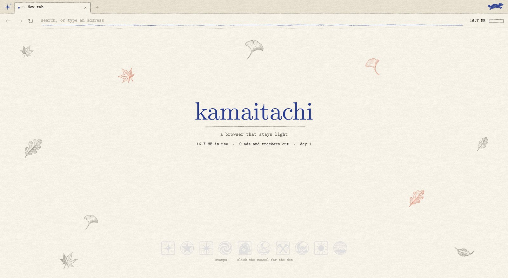

# kamaitachi

kamaitachi is a web browser for Windows that tries to use as little memory as it can. Most pages go through its own engine, which parses the HTML and CSS, lays the page out and paints it on the CPU into a single buffer. Sites that are really applications, like YouTube or Zoom, open in Chromium (the WebView2 runtime that comes with Windows), and only when one of them needs it.




These are private bytes, measured on a Windows 11 laptop in November 2026.

| page | engine | memory |
|---|---|---|
| new tab | own | 7.3 MB |
| Hacker News | own | 9 MB |
| a long Wikipedia article | own | 34 MB |
| a YouTube video page | Chromium | 9 MB + 298 MB |

The budget is 500 MB for both. When the total gets close, the tab you looked at longest ago is parked. Its Chromium process exits and the tab keeps a screenshot, so clicking it brings the page back.

The kamaitachi is a weasel from Japanese folklore that rides whirlwinds and cuts too fast to see.

## install

Download `kamaitachi.exe` and `install.ps1` from the latest release into one folder, then run:

```powershell
powershell -ExecutionPolicy Bypass -File install.ps1
```

It installs for your user only, adds kamaitachi to the Start menu and lists it under Default apps. `-Uninstall` takes it out again. The exe is not signed yet, so Windows SmartScreen will ask before it first runs.

## build and run

```sh
cargo build --release
target/release/kamaitachi.exe                      # opens a new tab
target/release/kamaitachi.exe news.ycombinator.com  # one tab per address
```

It needs Windows 10 or 11 and Rust 1.88 or newer. The ad blocker, [omamori](https://github.com/Cintu07/omamori), comes from its own repo.

## two engines

A page starts in the light engine. If the page is really a JavaScript application, kamaitachi reopens it in Chromium. It looks for pages with almost no text, a notice asking for JavaScript, or a bot check. That choice is remembered per site in `%APPDATA%\hayate\engines.txt`. The LITE / FULL switch in the toolbar, or `Ctrl+Shift+E`, flips it by hand.

The light engine has no JavaScript at all. It handles block, inline, float, flex, grid and table layout, CSS variables, `calc()` and media queries, and it decodes images at the size they are shown. It does not draw SVG yet, and forms do not submit.

Chromium starts with flags. Each one saved memory on a YouTube video page. Turning off the GPU process took the total from 631 MB to 412 MB, and V8's lite mode cut the page's renderer from 301 MB to 190 MB. Video then decodes on the CPU, which costs battery while it plays. Set `HAYATE_CHROMIUM_ARGS` to replace the flags.

## blocking

Ads, trackers, malware and phishing are blocked by omamori. It reads EasyList, EasyPrivacy, uBlock Origin's own lists, URLhaus and the Phishing URL Blocklist. That is about 300,000 rules, and they take 4.85 MB. The lists are downloaded to `%APPDATA%\hayate\filters` and fetched again after four days.

A page that is on a malware or phishing list does not load at all. You get a warning page with a way back, plus a way through if you know better. `hayate filters` prints the rule counts and memory, and `HAYATE_NOBLOCK=1` turns blocking off.

## keys

| keys | does |
|---|---|
| `Ctrl+L` | address bar, type an address or words to search |
| `Ctrl+T`, `Ctrl+W` | new tab, close tab |
| `Ctrl+Tab`, `Ctrl+1` to `9` | next tab, a tab by number |
| `Alt+Left`, `Alt+Right` | back, forward |
| `Ctrl+Shift+E` | this site in the other engine |
| `Ctrl+Shift+K` | the next skin |
| `Ctrl` `+` / `-` / `0` | zoom |
| `F5` | reload |

Drag an image onto the window and it becomes the new tab's wallpaper.

## skins and the den

joseon is the default look. The chrome and the new tab are a sheet of paper, drawn in graphite and cobalt ink with a wash of sky blue, and set in CMU Typewriter and CMU Serif. The pencil is drawn by the cpu into the frame, in the spirit of p5.brush but without a browser engine under it. It costs about 4 ms a frame at 1080p, plus 64 KB of paper grain. The weasel, the stamps and the season doodles are drawings kept as 65 KB of grayscale masks that the skin colors when they are printed. night is the older dark one. Three more open up as the blocker works, wave once 100 ads and trackers are blocked, then neon at 1,000 and gameboy at 10,000.

A small weasel in the tab strip eats whatever gets blocked, and it changes form at 100, 1,000, 10,000 and 100,000. Click it to open the den, a page with the counts, ten stamps to collect and the skins you have. The counts stay in `%APPDATA%\hayate\stats.txt` and never leave the machine. There are no streaks to keep up and no notifications. All of it has to fit in 1 MB, and a test checks that.

## settings

| variable | does |
|---|---|
| `HAYATE_BUDGET_MB` | the memory budget, 500 by default |
| `HAYATE_RENDER=gpu` | draw with Direct3D instead of the CPU, which costs about 115 MB of driver memory on an integrated GPU |
| `HAYATE_NOBLOCK=1` | no blocking |
| `HAYATE_CHROMIUM_ARGS` | the flags Chromium starts with |

## hayate

This repo started as hayate, a terminal client for X and YouTube that also talks to Claude and ChatGPT. That program is still here as `hayate.exe`, and the browser's engine grew out of its reader. Setting it up is covered in [docs/hayate.md](docs/hayate.md), along with its keys and memory budgets.

## license

MIT. The fonts in `assets/fonts` are Computer Modern Unicode under the SIL Open Font License, which is in the same folder. Filter lists and wallpapers are downloaded when the browser runs, so neither is part of this repo.
