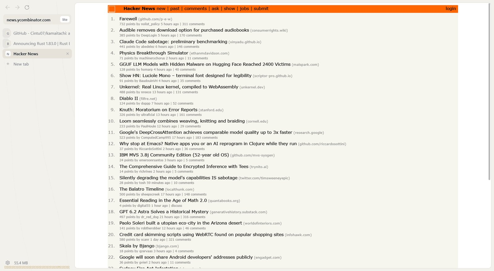

# kamaitachi

kamaitachi is a web browser for Windows that tries to use as little memory as it can. Most pages go through its own engine, which parses the HTML and CSS, lays the page out and paints it on the CPU into a single buffer. Sites that are really applications, like YouTube or Zoom, open in Chromium (the WebView2 runtime that comes with Windows), and only when one of them needs it.




These are private bytes on a Windows 11 laptop in November 2026, eight seconds after starting, with blocking on and a window of 1924 by 1055 pixels. The frame itself is 7.7 MB of each number. The first three rows were measured on 28 November. The Wikipedia rows are from 25 November, with the earlier look, since Wikipedia started refusing this laptop after many test loads. The YouTube row is older still and used a smaller frame.

| page | engine | memory |
|---|---|---|
| new tab | own | 16.5 MB |
| Hacker News | own | 18.0 MB |
| a Rust blog post | own | 20.6 MB |
| a short Wikipedia article (Kamaitachi) | own | 24.6 MB |
| a very long one (World War II) | own | 69 MB |
| a YouTube video page | Chromium | 9 MB + 298 MB |

The budget is 500 MB for both. When the total gets close, the tab you looked at longest ago is parked. Its Chromium process exits and the tab keeps a screenshot, so clicking it brings the page back.

The kamaitachi is a weasel from Japanese folklore that rides whirlwinds and cuts too fast to see.

## install

Download `kamaitachi.exe` and `install.ps1` from the latest release into one folder, then run:

```powershell
powershell -ExecutionPolicy Bypass -File install.ps1
```

It installs for your user only, adds kamaitachi to the Start menu and lists it under Default apps. `-Uninstall` takes it out again. The exe is not signed yet, so Windows SmartScreen will ask before it first runs.

## android

There is an Android build too, `kamaitachi.apk` (1.6 MB) on the releases page. It needs Android 11 or newer on a 64-bit ARM phone. Open the download on the phone. Android will ask once whether your browser may install apps.

Pages go through the same engine and ad blocker as on Windows, with text drawn from the phone's own fonts. Sites that need JavaScript open in the phone's System WebView, and the lite / full switch in the toolbar moves a site between the two. Images are not drawn yet. Grey boxes show where they go. The app has not been tested on a phone, so treat it as an experiment.

`android/build.sh` builds it with the Android SDK, NDK and cargo-ndk. Gradle is not needed.

## build and run

```sh
cargo build --release
target/release/kamaitachi.exe                      # opens a new tab
target/release/kamaitachi.exe news.ycombinator.com  # one tab per address
```

It needs Windows 10 or 11 and Rust 1.88 or newer. The ad blocker, [omamori](https://github.com/Cintu07/omamori), comes from its own repo.

## two engines

A page starts in the light engine. If the page is really a JavaScript application, kamaitachi reopens it in Chromium. It looks for pages with almost no text and no form, or a notice asking for JavaScript. That choice is remembered per site in `%APPDATA%\hayate\engines.txt`. A bot check opens in Chromium too, but only that once. The lite / full switch at the end of the address, or `Ctrl+Shift+E`, flips it by hand.

The light engine has no JavaScript at all. It handles block, inline, float, flex, grid and table layout, CSS variables, `calc()` and media queries, and it decodes images at the size they are shown. Forms work, except for file uploads. It does not draw SVG yet.

Cookies are only kept for the site in the address bar, so one set by an image or a stylesheet from elsewhere is dropped. They are stored in `%APPDATA%\hayate\cookies`, encrypted with your Windows account, and Settings has a button that forgets them all. Chromium keeps its own, so signing in with one engine does not sign you in with the other.

Chromium starts with flags. Each one saved memory on a YouTube video page. Turning off the GPU process took the total from 631 MB to 412 MB, and V8's lite mode cut the page's renderer from 301 MB to 190 MB. Video then decodes on the CPU, which costs battery while it plays. Set `HAYATE_CHROMIUM_ARGS` to replace the flags.

## blocking

Ads, trackers, malware and phishing are blocked by omamori. It reads EasyList, EasyPrivacy, uBlock Origin's own lists, URLhaus and the Phishing URL Blocklist. That is about 300,000 rules, and they take 4.85 MB. The lists are downloaded to `%APPDATA%\hayate\filters` and fetched again after four days.

A page that is on a malware or phishing list does not load at all. You get a warning page with a way back, plus a way through if you know better. `hayate filters` prints the rule counts and memory, and `HAYATE_NOBLOCK=1` turns blocking off.

## keys

| keys | does |
|---|---|
| `Ctrl+L` or `Ctrl+K` | the address field: an address, words to search, or a few letters of an open tab |
| `Ctrl+T`, `Ctrl+W` | new tab, close tab |
| `Ctrl+Tab`, `Ctrl+1` to `9` | next tab, a tab by number. Hold `Ctrl` to see the numbers |
| `Ctrl+S` | put the column of tabs away, or bring it back |
| `Ctrl+,` | settings |
| `Ctrl+Shift+T` | open the last closed tab again |
| `Alt+Left`, `Alt+Right` | back, forward |
| `Ctrl+Shift+E` | this site in the other engine |
| `Ctrl+Shift+H` | hide a box on this site for good: point, widen with the arrows, click |
| `Ctrl+Shift+R` | reading view |
| `Ctrl+M` | mute a page in Chromium |
| `Ctrl` `+` / `-` / `0` | zoom |
| `F5` | reload |

Tabs from last time come back when kamaitachi starts, and each one loads only when you open it.

Drag an image onto the window and it becomes the new tab's wallpaper.

## the look, and changing it

The window is white marble with Aegean blue. The tabs are a column down the left and the page is a card beside it, with nothing above it. The address sits at the top of the column, and `Ctrl+L` brings it up over the page as a field that also finds open tabs. A tab fills with grey as you read down its page, and a tab that has let its page go is dimmed. Along the foot of the column runs a band of Greek key in gold. It is drawn as one-pixel lines, and the marble veins are two pencil strokes, so neither is kept in memory as a picture. Night puts the same layout on dark slate, with the accent made lighter so it still reads.

Settings is a page of its own, at `kamaitachi.local/settings`, with a box that finds a setting by its words. There you can pick light, dark or whatever Windows uses, one of six accent colours, the tabs on the left or the right, how wide the column is, roomier tabs, the card or edge to edge, the search engine and the page zoom. Tabs can sleep after 10, 30 or 60 minutes and close after a day or a week. Click trackers can be taken out of links, and Global Privacy Control sent with every page. Every choice is written to `%APPDATA%\hayate\settings.txt` as one `name = value` line, which can also be edited by hand.

## environment variables

| variable | does |
|---|---|
| `HAYATE_BUDGET_MB` | the memory budget, 500 by default |
| `HAYATE_RENDER=gpu` | draw with Direct3D instead of the CPU, which costs about 115 MB of driver memory on an integrated GPU |
| `HAYATE_NOBLOCK=1` | no blocking |
| `HAYATE_CHROMIUM_ARGS` | the flags Chromium starts with |

## hayate

This repo started as hayate, a terminal client for X and YouTube that also talks to Claude and ChatGPT. That program is still here as `hayate.exe`, and the browser's engine grew out of its reader. Setting it up is covered in [docs/hayate.md](docs/hayate.md), along with its keys and memory budgets.

## license

MIT. The fonts in `assets/fonts` are Computer Modern Unicode under the SIL Open Font License, which is in the same folder. Filter lists and wallpapers are downloaded when the browser runs, so neither is part of this repo.
